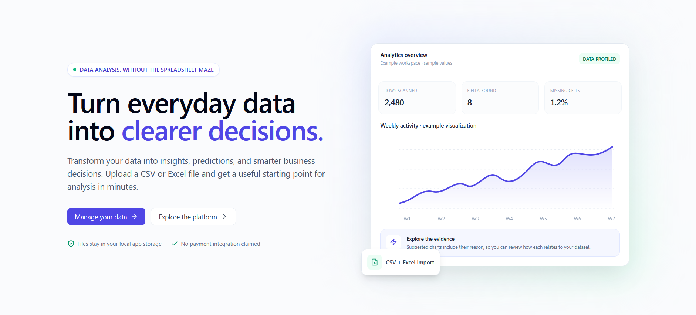
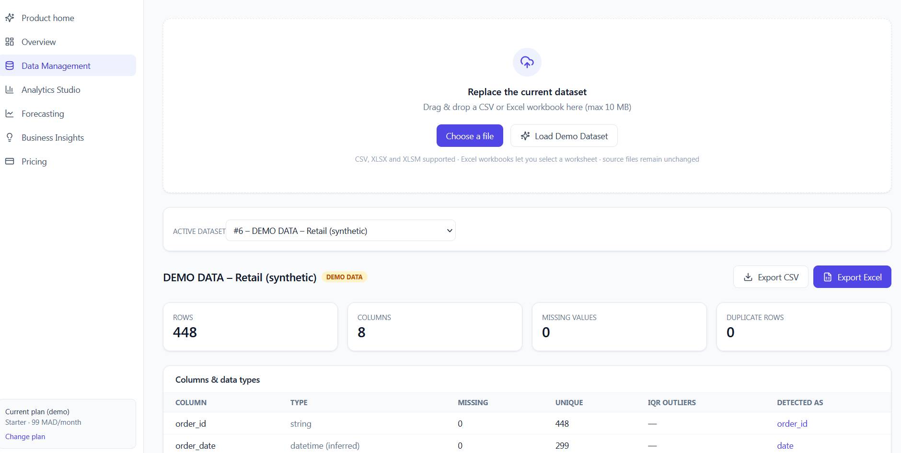
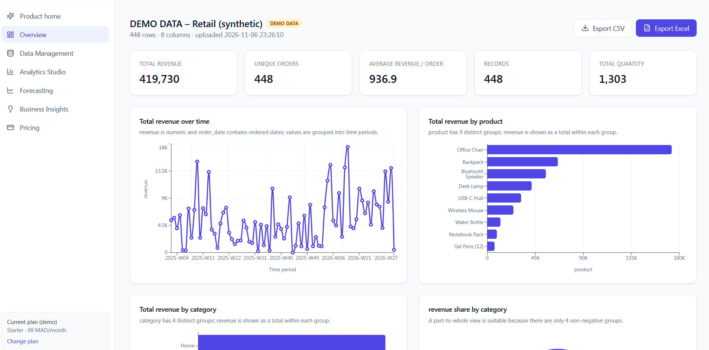
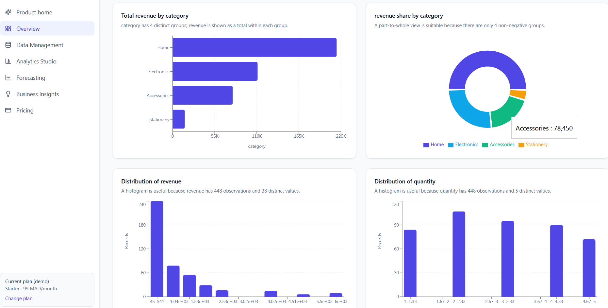
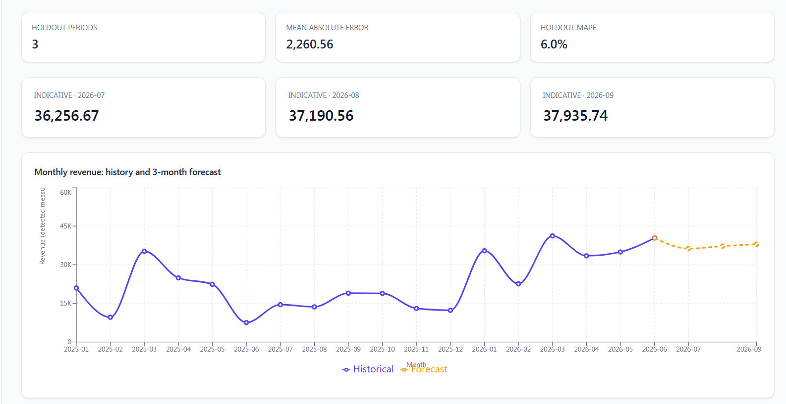
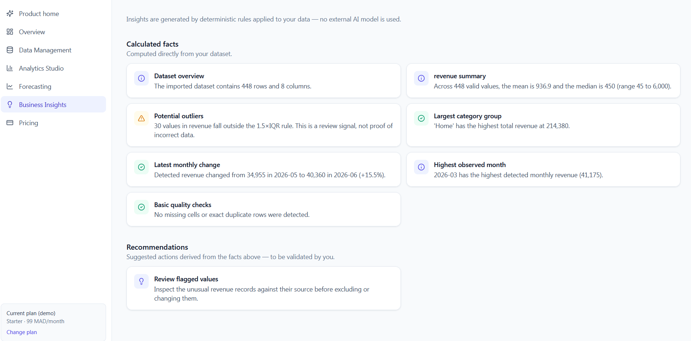
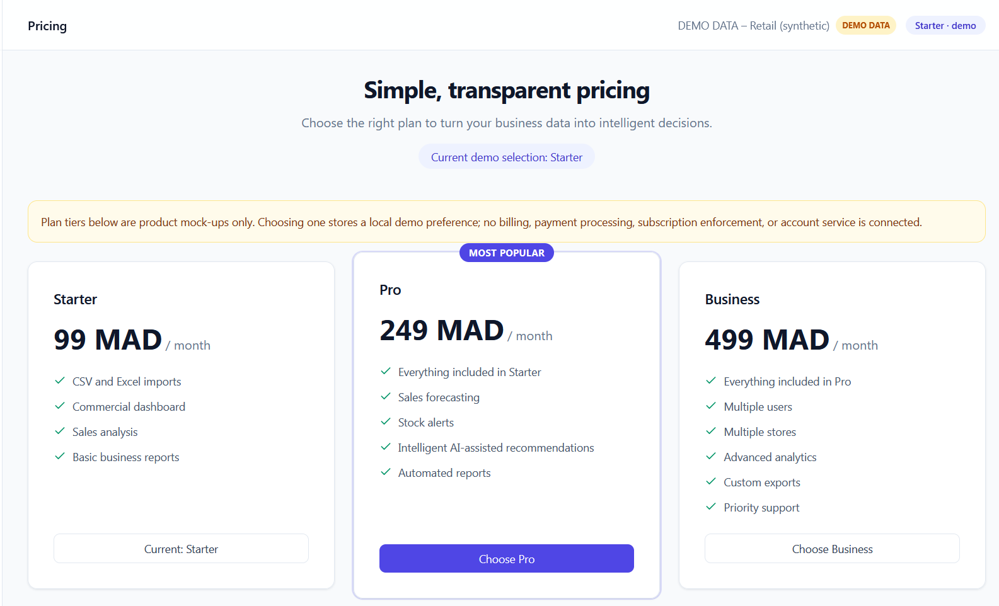

# PERDICIA
### Business Intelligence & Data Analytics Platform

<p align="center">
  
</p>

<h3 align="center">Turn Business Data Into Actionable Intelligence.</h3>

<p align="center">
  Transform raw data into meaningful insights, interactive analytics, and better business decisions.
</p>

<p align="center">
  <strong>Business Intelligence · Data Analytics · Predictive Insights · SaaS</strong>
</p>

---

## 1. Overview

**PERDICIA** is a modern, SaaS-oriented Business Intelligence and data analytics platform designed to help businesses transform raw data into meaningful information and actionable insights.

Built with **React, TypeScript, FastAPI, Python, Pandas, and Recharts**, PERDICIA provides an analytical workspace where users can import CSV and Excel files, explore datasets, identify data quality issues, visualize business indicators, and extract useful information from their data.

The platform aims to simplify data analysis and make Business Intelligence more accessible to small businesses, growing companies, business analysts, and decision-makers.

Instead of spending hours manually exploring spreadsheets and preparing reports, users can leverage an organized analytical environment to better understand their data and support business decisions.

**Our vision: make data more understandable, analytics more accessible, and business decisions more intelligent.**

---

## 2. Platform Preview

Explore the main interfaces and analytical capabilities of PERDICIA.

### 2.1 Main Dashboard

The main interface introduces the PERDICIA workspace and provides access to its analytical environment.

<p align="center">
  
</p>

### 2.2 Data Management

Import, manage, and explore business datasets through a centralized data management interface.

<p align="center">
  
</p>

### 2.3 Business Overview

Get a clearer overview of your dataset through analytical indicators, summaries, and interactive visualizations.

<p align="center">
  
</p>

### 2.4 Detailed Analytics Overview

Continue exploring your data through additional analytical visualizations and business information.

<p align="center">
  
</p>

### 2.5 Forecasting

Explore historical trends and statistical forecasting through a three-month moving-average baseline when sufficient monthly data is available.

<p align="center">
  
</p>

### 2.6 Business Insights

Discover rule-based analytical insights derived from your datasets to identify relevant patterns and potential areas requiring attention.

<p align="center">
  
</p>

### 2.7 Pricing & Subscription Plans

PERDICIA follows a subscription-oriented SaaS business model with three proposed plans designed for different business needs.

<p align="center">
  
</p>

---

## 3. The Problem We Solve

Businesses generate large amounts of information through sales, operations, customers, inventory, finance, and other activities.

However, raw data alone does not provide business value.

Many organizations still face challenges such as:

- Time-consuming spreadsheet analysis.
- Difficulty understanding large datasets.
- Limited visibility into business performance.
- Manual reporting and calculations.
- Missing values and inconsistent data.
- Difficulty identifying important trends.
- Limited access to analytical tools.

PERDICIA addresses these challenges by providing an accessible analytical workspace that helps transform raw business information into structured insights.

**From data collection to data understanding. From data understanding to better decisions.**

---

## 4. Core Features

### Data Import & Management

- CSV file importing.
- Excel workbook support (`.xlsx` and `.xlsm`).
- Automatic detection of common CSV delimiters and encodings.
- Excel worksheet selection.
- File validation and size management.
- Local dataset storage.
- Dataset preview and exploration.

### Automated Data Profiling

Understand your dataset through automated profiling.

- Dataset dimensions (rows and columns).
- Column names and detected data types.
- Missing-value analysis.
- Exact duplicate-row detection.
- Numerical statistics.
- Potential identifier detection.
- IQR-based outlier counts.
- Initial data quality indicators.

### Intelligent Data Visualization

Explore data through interactive and automatically suggested visualizations.

- Automatic chart suggestions.
- Date-based analysis.
- Numerical and categorical exploration.
- Interactive charts.
- Visualization recommendations with explanations.
- Dynamic analytical exploration.

### Business Intelligence & KPIs

Transform raw records into meaningful analytical indicators.

- Generic record and measure KPIs.
- Numerical summaries.
- Business-oriented indicators.
- Filtered analytical views.
- Data-driven insights.
- Interactive dashboards.

### Business Insights

Go beyond basic data exploration.

PERDICIA provides rule-based insights derived from observed data to highlight relevant information and potential areas requiring attention.

These insights are computed using analytical rules rather than an external generative AI service.

### Forecasting & Trend Analysis

For datasets with sufficient monthly history, PERDICIA provides a statistical revenue baseline.

- Historical monthly analysis.
- Three-month moving-average baseline.
- Retrospective holdout error.
- Forecast visualization.

*Note: This is a statistical baseline, not an advanced machine-learning forecasting engine or a guaranteed business projection.*

### Data Export & Reporting

- CSV exports.
- Excel exports.
- Spreadsheet-safe handling of formula-like text.
- Analytical results suitable for further reporting and analysis.

---

## 5. Business Value

PERDICIA is designed to help businesses reduce the time between collecting information and understanding what it means.

| Business Challenge | PERDICIA Solution |
|---|---|
| Manual spreadsheet analysis | Automated data profiling |
| Limited business visibility | KPIs and dashboards |
| Data quality problems | Missing-value and duplicate detection |
| Time-consuming reporting | Analytical exports |
| Difficult data exploration | Automatic chart suggestions |
| Limited trend visibility | Statistical baseline forecasting |
| Disconnected datasets | Centralized local analytics workspace |

### Who Can Benefit?

**Small & Medium-Sized Businesses**

Understand business performance and explore operational data through accessible analytics.

**Retail & E-commerce**

Analyze sales, products, customers, and business performance.

**Finance & Administration**

Explore numerical records, monitor indicators, and prepare analytical reports.

**Operations & Supply Chain**

Analyze inventory, suppliers, purchasing, and operational datasets.

**Business Analysts**

Accelerate data exploration and discover relevant analytical directions.

**Management & Decision-Makers**

Access clearer summaries of business information to support strategic discussions and decisions.

---

## 6. SaaS Business Model & Pricing

PERDICIA is designed around a subscription-based B2B SaaS business model.

The proposed commercial offering consists of three plans.


### Pricing Comparison

| Feature | Starter | Pro | Business |
|---|:---:|:---:|:---:|
| CSV & Excel Import | ✓ | ✓ | ✓ |
| Sales Dashboard | ✓ | ✓ | ✓ |
| Sales Analysis | ✓ | ✓ | ✓ |
| Business Indicators | ✓ | ✓ | ✓ |
| Simple Reports | ✓ | ✓ | ✓ |
| Forecasting | — | ✓ | ✓ |
| Stock Alerts | — | ✓ | ✓ |
| AI-Assisted Recommendations | — | ✓ | ✓ |
| Automated Reporting | — | ✓ | ✓ |
| Multiple Users & Stores | — | — | ✓ |
| Advanced Analysis | — | — | ✓ |
| Custom Exports | — | — | ✓ |
| Priority Support | — | — | ✓ |

*Commercial pricing and plan features represent the proposed SaaS offering. The current pricing interface is a prototype; real payments, accounts, subscription enforcement, and plan-specific access controls are not yet implemented.*

---

## 7. Technology Stack

PERDICIA combines modern frontend technologies with a Python-based analytical backend.

| Component | Technology |
|---|---|
| Frontend | React |
| Programming Language | TypeScript |
| Styling | Tailwind CSS |
| Data Visualization | Recharts |
| Backend | Python |
| API Framework | FastAPI |
| Data Processing | Pandas, NumPy |
| Excel Processing | OpenPyXL |
| API Server | Uvicorn |
| Local Database | SQLite |
| Frontend Tooling | Vite |
| Development Scripts | Windows Batch, PowerShell |

### System Architecture

```text
                  USER
                    |
                    v
          React + TypeScript
          Tailwind + Recharts
                    |
                    v
              FastAPI REST API
                    |
                    v
          Python Data Processing
                    |
          +---------+----------+
          |         |          |
          v         v          v
       Profiling Analytics Forecasting
          |         |          |
          +---------+----------+
                    |
                    v
            SQLite / Local Storage
                    |
                    v
           Insights & Data Exports
```

---

## 8. Current Scope & Limitations

PERDICIA is currently a local analytics workspace with a SaaS-oriented product design.

The following limitations apply to the current implementation:

- Column-role inference is heuristic and may require user verification.
- Ambiguous columns such as `amount` are not automatically interpreted as revenue.
- Data quality indicators should be checked against the original dataset.
- Insights are rule-based and are not generated by an external AI model.
- Forecasting uses a moving-average baseline rather than advanced machine learning.
- The pricing interface is a prototype and does not process real payments.
- User accounts, subscription enforcement, and multi-user access are not implemented.
- Local development storage is not a production-grade cloud infrastructure.

Before exposing the platform publicly or using it with sensitive business information, appropriate authentication, authorization, encryption, retention controls, deployment hardening, and security reviews are necessary.

---

## 9. Future Roadmap

The long-term vision is to evolve PERDICIA from a local analytics workspace into a complete Business Intelligence SaaS platform.

Potential development directions:

- [ ] Secure authentication and user management.
- [ ] Organization and workspace management.
- [ ] Subscription management and payment integration.
- [ ] Cloud-based dataset storage.
- [ ] Multi-user and multi-store environments.
- [ ] Advanced business dashboards.
- [ ] Improved predictive analytics.
- [ ] AI-assisted business recommendations.
- [ ] Automated scheduled reporting.
- [ ] Advanced inventory monitoring.
- [ ] Configurable analytical workflows.
- [ ] Production deployment and scalability improvements.

These items represent future development objectives rather than currently available features.

---

## 10. Why PERDICIA?

PERDICIA brings together several important dimensions of modern data engineering and Business Intelligence:

- Data ingestion and processing.
- Data quality exploration.
- Analytical computation.
- Business KPI development.
- Interactive visualization.
- Statistical analysis.
- API-driven software architecture.
- Exportable analytical results.
- SaaS product design.

The project demonstrates how software engineering and data analytics can work together to transform raw business information into something more understandable, accessible, and useful.

**PERDICIA is built around one objective: helping businesses move from raw data to better-informed decisions.**

---

## 11. Project Information

| Information | Details |
|---|---|
| Product Name | PERDICIA |
| Category | Business Intelligence & Data Analytics |
| Product Type | SaaS-oriented analytics platform |
| Frontend | React, TypeScript, Tailwind CSS, Recharts |
| Backend | Python, FastAPI, Pandas |
| Database | SQLite |
| Supported Formats | CSV, XLSX, XLSM |
| Business Model | Subscription-based SaaS concept |

---

<p align="center">
  
</p>

<h2 align="center">PERDICIA</h2>

<p align="center">
  <strong>Turn Business Data Into Actionable Intelligence.</strong>
</p>

<p align="center">
  Business Intelligence · Data Analytics · Predictive Insights
</p>
# perdicia

